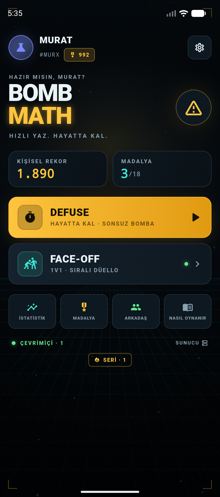
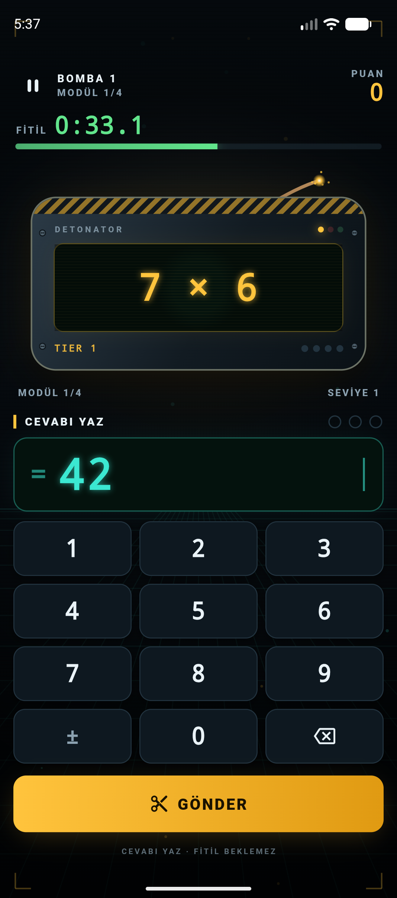
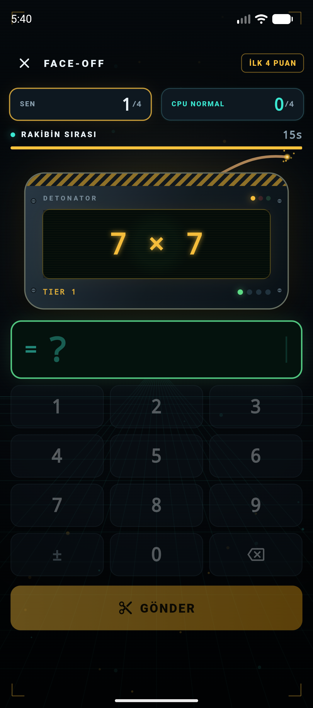
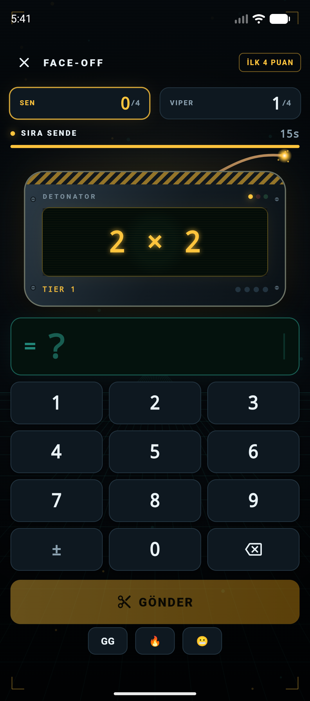
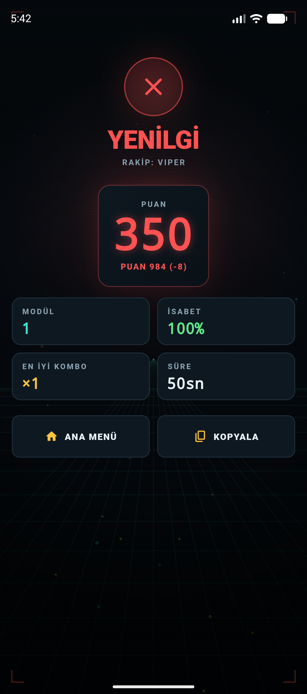
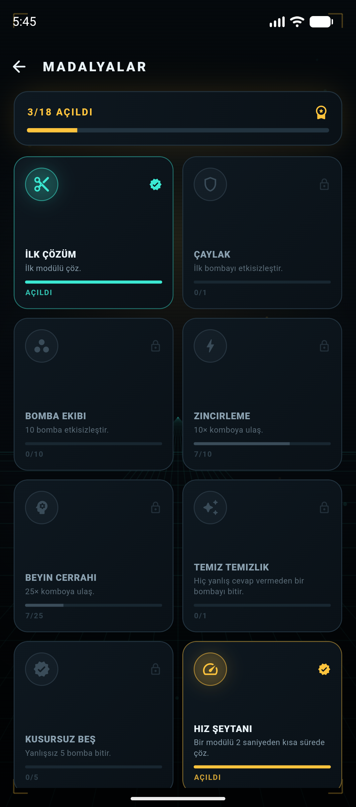
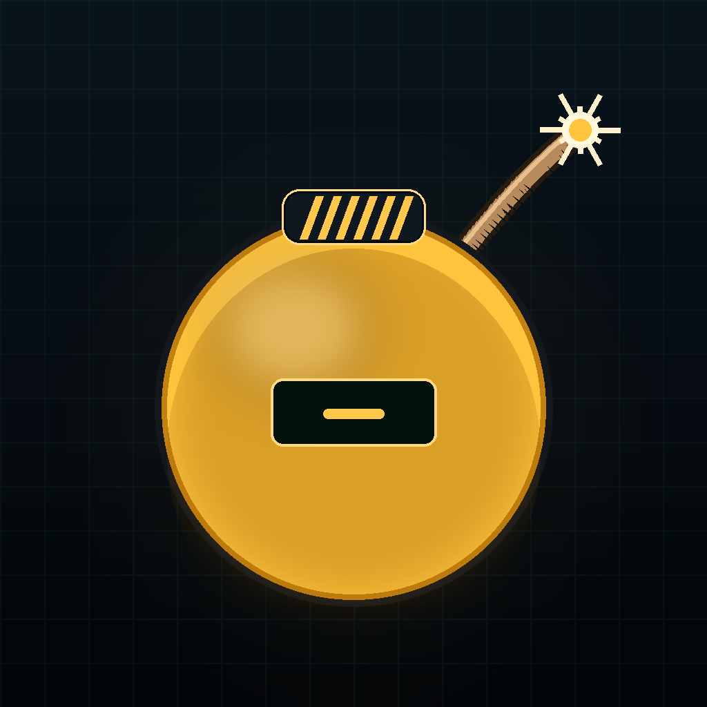

# BOMB MATH

**Type fast. Stay alive.**
A bomb-disposal math arcade for Android, built with Flutter.

The bomb shows an equation. Type the answer on the keypad, disarm the module and
chain solves for a combo multiplier before the fuse runs out. The ladder starts at
multiplication and gets harder with every module. In **Face-Off**, two players
alternate turns on the same ladder — first to four correct answers wins.

There are **no multiple-choice answers**: every response is typed.

---

## Features

- **DEFUSE** — solo survival: 45 s fuse, 3 strikes, 4 modules per bomb, a 10-tier
  multiplication-first ladder, combo up to 3×, personal best tracking.
- **FACE-OFF** — turn-based 1v1: 15 seconds per turn, one question per turn, first
  to 4 points. Wrong answers and timeouts pass the turn.
- **Typed answers** — large numeric keypad with sign toggle, backspace and submit;
  physical keyboard support (digits, minus, backspace, Enter).
- **Practice bots** — EASY / NORMAL / HARD / MASTER with different accuracy and
  thinking speed, fully offline.
- **Online** — quick match, private rooms, friend challenges, live turn/score
  updates, emotes and Elo-style rating.
- **Profile & friends** — call sign, tag, friend code, friend list with presence.
- **18 medals** with live progress, **statistics** with accuracy ring, score trend
  and match history.
- **English + Turkish** interface with system-language selection.
- **Procedural audio** — every sound effect and the music loop are original,
  synthesized by `tool/synth_audio.py` (no third-party samples).
- **Accessibility** — reduced motion, high-contrast theme, haptics toggle, large
  tap targets and hardware-keyboard input.

---

## Screenshots

| Home | Defuse (typed) | Face-Off |
|---|---|---|
|  |  |  |

| Online turn | Online result | Medals |
|---|---|---|
|  |  |  |

More in [`docs/screenshots`](docs/screenshots): solo result, wrong answer, pause,
statistics, friends, settings (TR), how-to.



---

## Requirements

- Flutter **3.41.8** / Dart **3.11.5** (`C:\flutter` on this machine)
- Android SDK **37**, build-tools **37**, JDK **21**, Gradle **8.14**
- Application id `com.valensass.bomb_math`

## Build and run

```powershell
flutter pub get
flutter run -d emulator-5554        # debug
flutter build apk --release --split-per-abi
```

Release APKs land in `build/app/outputs/flutter-apk/`:
`app-arm64-v8a-release.apk` (phones), `app-x86_64-release.apk` (emulator).

## Tests

```powershell
flutter analyze     # no issues
flutter test        # 34 tests
```

Coverage includes the multiplication-first generator ladder and determinism, solo
typed-answer scoring / strikes / fuse / bomb interlude, turn alternation, first-to-4
wins, turn limits, bot accuracy/speed, medals, and onboarding/home widget flow.

## Multiplayer

The game ships with a small Dart match server (WebSocket + JSON persistence). The
server owns turn order and the 15-second deadline.

```powershell
cd server
dart pub get
dart run bin/server.dart        # listens on 0.0.0.0:8080
```

In the app: **Home → SERVER**, or Settings → ONLINE → MANAGE.

- Android emulator: `ws://10.0.2.2:8080/ws` (default)
- Physical phone on the same Wi-Fi: `ws://<your-PC-LAN-IP>:8080/ws`
- HTTP health: `http://127.0.0.1:8080/health`
- Leaderboard: `http://127.0.0.1:8080/api/leaderboard`

Profiles and the last 200 matches are stored in `server/data/*.json`.
The server is a development/LAN service: it has no TLS, authentication, or
server-side answer validation. **Do not expose it to the public internet.**

Turn-based smoke test (starts its own server on port 8099):

```powershell
dart run tool/mp_smoke_test.dart
```

Scripted opponent for manual online testing:

```powershell
dart run tool/opponent_bot.dart --name VIPER
```

## Project layout

```
lib/
  core/        theme, localization (EN/TR), audio pool, haptics
  game/        math generator, solo engine, turn duel engine, bot, medals
  data/        models, persistence, profile/stat/settings state
  services/    WebSocket multiplayer client
  ui/          screens, answer keypad, bomb painter, FX, sheets
server/        shelf + WebSocket turn-based match server
tool/          audio synthesis, multiplayer smoke test, scripted opponent
test/          unit + widget tests
docs/          game design, implementation report, screenshots
```

## Audio assets

All WAV files are generated from code:

```powershell
python tool/synth_audio.py
```

## Known limitations

- Release builds are signed with the template debug key; configure a real
  signing key before distribution.
- The server trusts the active client’s `correct` flag; it enforces turn order but
  does not validate the arithmetic answer or recompute Elo.
- Ratings are computed on-device and stored in the server profile snapshot.
- The match server is intended for local/LAN play only.
- iOS is not configured; the deliverable is Android.
- Debug builds on the emulator disable Impeller (see
  `android/app/src/debug/AndroidManifest.xml`); release builds keep Flutter’s
  default Impeller renderer.

## License

Original code and generated audio. No third-party game assets are bundled.
